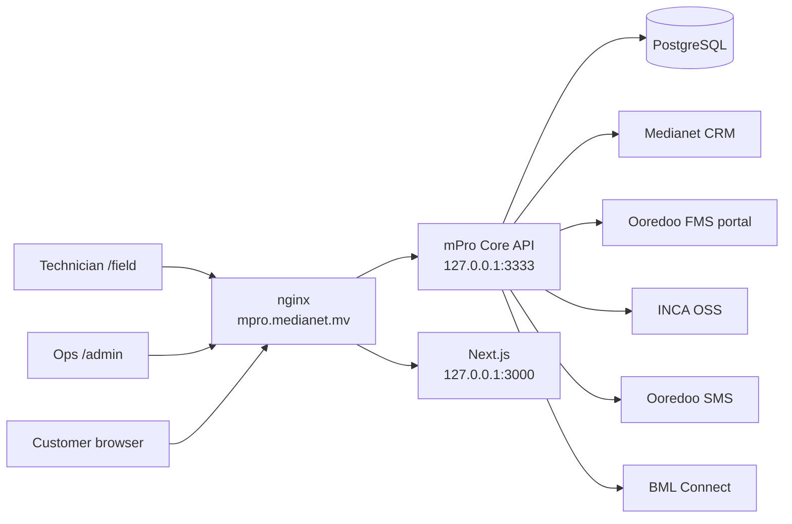

# mPro (Ticketify) — Full Technical Handbook

**Audience:** Anyone who must explain, operate, or extend this project.  
**Last updated:** 2026-11-17  
**Production URL:** https://mpro.medianet.mv  
**API base:** https://mpro.medianet.mv/api/v1  
**GitHub:** https://github.com/Roak-kenandy/ticketify (branch `main`)

This handbook covers the product from zero: what it is, how pieces connect, Medianet CRM flows, Ooredoo FMS integration, how to create users, how to deploy, and how to troubleshoot. Related deeper docs live in the same folder (`ARCHITECTURE.md`, `SECURITY.md`, finance/LM phase docs).

---

## 1. What this product is (30-second pitch)

**mPro** is Medianet’s field-operations console. Technicians and office staff use one web app. The NestJS API talks to:

| External system | Role for mPro |
|-----------------|---------------|
| **Medianet CRM Backoffice** | Source of truth for Medianet service requests (SRs) |
| **Ooredoo FMS portal** | Source of truth for Ooredoo tickets (scraped/posted over a shared “tech2” login) |
| **PostgreSQL** | Users, roles, RBAC, local mirrors, finance, inventory, FMS ownership rows |
| **INCA OSS** | ONT search/register (Medianet installs) |
| **BML Connect** | Customer payments |
| **Ooredoo Bulk SMS** | SMS notifications |
| **OneSignal** | Push (optional) |
| **Traccar Client** | Technician GPS |

**Important dual-source rule:** every mPro user is either `MEDIANET` or `OOREDOO`. Ticket APIs branch on that. Medianet techs never hit FMS; Ooredoo techs never hit CRM ticket lists.

---

## 2. Repository layout

```
ticketify/                          # monorepo root (Git)
├── ticketify-core-api-main/        # NestJS API (port 3333)
├── ticketify-admin-panel-main/     # Next.js UI (port 3000) — /field + /admin
├── docs/                           # This handbook + architecture / security / phase docs
└── .github/workflows/api-ci-cd.yml # CI build (+ unused cloud deploy)
```

| App | Stack | Local command |
|-----|-------|---------------|
| API | NestJS 10, Prisma 5, PostgreSQL, Passport JWT | `cd ticketify-core-api-main && npm run start:dev` |
| Admin / Field UI | Next.js 15, React 18 | `cd ticketify-admin-panel-main && npm run dev` |

UI talks to API with:

- Base URL: `NEXT_PUBLIC_API_URL` (default `http://127.0.0.1:3333/api/v1`)
- Header: `Authorization: Bearer <access_token>`
- Token also mirrored to a non-HttpOnly `access_token` cookie for Next middleware on `/admin/*`

---

## 3. System context (who talks to whom)



**Production host:** `10.10.2.142` (office network).  
**Code path:** `/var/www/html/ticketify/`  
**PM2 processes:** `ticketify-core-api`, `ticketify-admin-panel` — **instances = 1** (required for FMS in-memory session).  
**SSH:** `mdn@10.10.2.142` (key `~/.ssh/medianet_live` and/or password). SSH is firewall-limited to office LAN / office public IP.

---

## 4. Authentication & roles (step by step)

### 4.1 Login flow

1. User opens https://mpro.medianet.mv and signs in.
2. UI → `POST /api/v1/auth/login` with email + password.
3. API checks argon2 hash, role, `is_active`, `token_version`.
4. Returns JWT (`JWT_EXPIRES_IN`, production often `8h`).
5. UI stores token in `localStorage` + cookie; all later calls send Bearer token.
6. Logout / password change / deactivate bumps `token_version` → old JWTs die on next request.

### 4.2 Rate limits & lockout

| Control | Value |
|---------|-------|
| Global API throttle | 120 requests / 60s |
| Login throttle | 5 / 60s |
| Failed-login lockout | 5 fails (email+IP) → 15 min; 30 fails (email) across IPs |

### 4.3 Authorization model

- JWT payload includes user id, email, `crm_user_id`, roles, `token_version`, and (via strategy reload) `source` + `ooredoo_user_id`.
- Screens use dynamic RBAC (`RolePermission` / `UserPermission` with NONE / VIEW / EDIT / DELETE).
- Flags such as `field_technician`, `full_access`, `stock_holder`, `store` still matter for field/stock UX.

---

## 5. Medianet (CRM) path — how a ticket works

**Gate:** `user.source === MEDIANET` (default).

### 5.1 End-to-end steps (field tech)

1. **Login** as Medianet technician (linked `crm_user_id` from CRM directory).
2. **List** — `GET /tickets` → API → CRM `service_requests` filtered by assignee.
3. **Open ticket** — `GET /tickets/:id` → CRM SR detail shaped for UI.
4. **Start** — `PUT /tickets/:id/start` → CRM action `START_PROGRESS` (+ optional SMS).
5. **Progress / notes / attachments** — CRM-backed endpoints (normal Medianet flow).
6. **Inventory / INCA** — declare materials; ONT register when `INCA_MODE=live`.
7. **Closure checks** — `PHASE2_CLOSURE_ENFORCED` / ONT inventory rules.
8. **Complete** — CRM close → SMS with customer review link.
9. **Finance** (office) — mPro invoices + BML (not CRM).

### 5.2 Co-tech helpers (Medianet only)

CRM still has **one** assignee. In mPro the primary tech can add up to **2 helpers** on the same ticket (`ticket_helpers`). Helpers see the ticket in their list, can add notes/photos, but CRM start/progress/close stay with the primary. When the customer submits **one** review, mPro writes the same rating/comment for the primary **and** every helper.

### 5.3 Creating a Medianet user (admin)

1. Admin → **Users → Create**.
2. Source = **MEDIANET**.
3. Pick **CRM team** → loads users from `GET /admin/directory/crm/teams` then `.../crm/users?team_id=`.
4. Select CRM person → sets `crm_user_id` (+ email typically from CRM).
5. Set password, role, flags → save.
6. Tech logs into mPro with that email/password (not CRM SSO).

**Directory adapters:** `CrmApiClient.listTeams` / `listTeamUsers` → CRM `/teams` and `/users?teams=`.

---

## 6. Ooredoo FMS path — full integration

This is the main dual-source work. FMS is a **session-based web portal**, not a clean public API. mPro logs in as one shared integration account and scrapes/posts HTML/forms.

### 6.1 Design principles (explain these first)

| Principle | Detail |
|-----------|--------|
| **One FMS login** | Env `OOREDOO_FMS_EMAIL` / `OOREDOO_FMS_PASSWORD` (tech2 / integration account). All portal HTTP uses that cookie jar. |
| **Many mPro techs** | Each Ooredoo tech is a normal mPro user with `source=OOREDOO` + unique `ooredoo_user_id` (FMS Assign-to-User id) + email that **must match** the FMS assignee email. |
| **Ownership locally** | Table `fms_ticket_assignments` mirrors who owns which FMS ticket under the shared login. |
| **Medianet untouched** | Controllers branch on `source` / numeric FMS ticket id — CRM code paths stay as before. |
| **Single process** | Cookie jar + caches are **in-memory**. PM2 must stay `instances=1`. No Redis FMS session yet. |

### 6.2 Key code map

| Piece | Path |
|-------|------|
| FMS HTTP client | `ticketify-core-api-main/src/infrastructure/ooredoo-fms/ooredoo-fms.client.ts` |
| Types / status / queues | `.../ooredoo-fms.types.ts` |
| Orchestration | `.../tickets/ooredoo-tickets.service.ts` |
| HTTP routes | `.../tickets/tickets.controller.ts` |
| DTOs | `.../tickets/dto/fms-edit.dto.ts` |
| Access helper | `.../infrastructure/security/ticket-access.service.ts` |
| Admin FMS/CRM dropdowns | `.../user/admin-directory.*` |
| Field edit UI | `ticketify-admin-panel-main/src/components/field/ticket/modals/fms-edit.tsx` |
| Relocation address UI | `.../modals/fms-address.tsx` |
| Ticket detail | `.../app/field/tickets/[id]/page.tsx` |
| User create | `.../app/admin/users/create/page.tsx` |

### 6.3 Database (Ooredoo-related migrations)

| Migration | What it adds |
|-----------|--------------|
| `20261115120000_user_source_ooredoo` | Enum `UserSource` (`MEDIANET` \| `OOREDOO`), `users.source`, `users.ooredoo_user_id` |
| `20261115130000_fms_ticket_attachments` | Legacy local attachment rows (new uploads go **to FMS**, not disk) |
| `20261115140000_fms_ticket_assignments` | `fms_ticket_id` → `ooredoo_user_id`, `assignee_email`, `assigned_by_user_id` |

Ooredoo users get a synthetic `crm_user_id` like `ooredoo-{fmsId}` so uniqueness constraints still hold.

### 6.4 Environment (API `.env`)

```bash
OOREDOO_FMS_ENABLED=true
OOREDOO_FMS_BASE_URL=https://www.ooredoo.mv/webapps/FMS/public
OOREDOO_FMS_EMAIL=...          # shared tech2
OOREDOO_FMS_PASSWORD='...'     # quote if password contains #
OOREDOO_FMS_TIMEOUT_MS=30000
OOREDOO_FMS_MAX_CONCURRENT=4   # keep low with 20+ techs
# HOST=127.0.0.1               # production bind (behind nginx)
# JWT_EXPIRES_IN=8h
```

Also ensure `CORS_ORIGINS` includes `https://mpro.medianet.mv`.

### 6.5 Creating an Ooredoo technician (admin) — steps

1. Admin → **Users → Create**.
2. Source = **OOREDOO**.
3. UI loads `GET /api/v1/admin/directory/fms/users` (parsed from FMS Assign-to-User list via shared session).
4. Pick FMS person → sets `ooredoo_user_id` + email.
5. Set mPro password + field role → save.
6. Tech logs into mPro. They see **only tickets assigned to their email / local assignment rows**, even though FMS portal login is shared.

### 6.6 Ticket list (Ooredoo) — steps

1. Tech opens Field → Tickets.
2. `GET /api/v1/tickets` → `OoredooTicketsService.listMine`.
3. Client fetches FMS **My Tickets** HTML (`/tickets/tickets_assigned`) once (cached ~120s, stale-while-revalidate up to 10 min).
4. Filter to rows where assignee email matches tech **or** `fms_ticket_assignments` says so.
5. Background `syncAssignments` keeps local ownership table warm.
6. Field UI polls Ooredoo lists every **120s** (lighter than Medianet) to avoid hammering FMS.

### 6.7 Ticket detail — steps

1. `GET /tickets/:id` (numeric FMS id, typically 3–12 digits).
2. Client loads `/tickets/ticket_info/:id` (detail cache ~120s).
3. Service maps HTML → CRM-shaped payload + `fms.*` block (status, queue, category, address, attachments with proxied file URLs).

### 6.8 Assign — steps

1. Self-assign: `PUT /tickets/:id/assign` (no body) → posts FMS `post_user_assign` with actor’s `ooredoo_user_id` → upserts `fms_ticket_assignments`.
2. Assign other: body `{ user_id, comment? }` (`FmsAssignDto`) → same FMS post + local upsert.
3. UI assign modal uses options from `GET /tickets/:id/fms/options`.

### 6.9 Edit priority / status / queue / category — steps

| Action | mPro route | FMS side |
|--------|------------|----------|
| Load options | `GET .../fms/options` | Parsed from ticket_info / related forms |
| Sub-categories | `GET .../fms/sub-categories/:categoryId` | `/get/sub_category/:id` |
| Priority | `PATCH .../fms/priority` | priority form post |
| Status | `PATCH .../fms/status` | Change_Ticket_Status |
| Queue | `PATCH .../fms/queue` | que_info |
| Category | `PATCH .../fms/category` | category_info |

All require comment fields as in `fms-edit.dto.ts`. After mutation, caches for that ticket (and often list) invalidate.

### 6.10 Relocation address edit — steps

**Rule:** only when ticket category/type/sub-category matches `/relocat/i`. Customer **name / mobile / email stay locked** on FMS; mPro edits address fields only.

1. UI shows **Change address** when `can_edit_address` is true.
2. `GET /tickets/:id/fms/address` → current form values.
3. Islands: `GET /tickets/:id/fms/islands?atoll_id=` → FMS `/get/bscs_island/:atollId`.
4. `PATCH /tickets/:id/fms/address` with `FmsAddressDto`:
   - Required: `address1`, `street`, `country_id`, `atoll_id`, `island_id`
   - Optional: `address2`, `company`, `zip`
5. Client posts `POST /tickets/post_new_installation_address` on FMS.

### 6.11 Attachments — steps

1. Tech uploads via normal field attachment UI.
2. For Ooredoo tickets: `POST /tickets/:id/attachments` → `OoredooFmsClient.uploadTicketAttachment` → FMS `POST /tickets/post_ticket_attachment` (multipart).
3. **Not** stored as primary files on mPro disk anymore.
4. Download: mPro proxies through the shared FMS session (`GET /tickets/:id/files/:file_id`), or falls back to legacy `fms_ticket_attachments` disk rows if any.

### 6.12 Complete / close — steps

1. Medianet-style “progress stages” are **rejected** for Ooredoo (400 — use Complete).
2. Close modal loads the same FMS TT status + sub-comment dropdowns as the portal (`GET .../fms/options`).
3. Tech picks **any** TT status (not forced to Fault Resolved), sub-comment, and comment.
4. `PUT /tickets/:id/complete` with `ticket_status`, `closing_sub_comment`, `comment` → FMS `Change_Ticket_Status`.
5. Allowed only if ticket is assigned to that tech (email match).

### 6.13 What Ooredoo deliberately skips

| Feature | Behavior for FMS tickets |
|---------|--------------------------|
| CRM teams queue | Empty list |
| CRM billing / charges | `charges_supported: false` / NOT_CHARGEABLE |
| CRM closure inventory gates | Treated ready / skipped |
| Status-board CRM buckets | Skipped in field home when source is OOREDOO |

### 6.14 Performance / scale notes (20+ techs)

- Shared session is fine: ownership is email + DB, not separate FMS logins.
- Keep `OOREDOO_FMS_MAX_CONCURRENT` around **4**.
- List/detail caches + list prefetch (~90s) reduce portal load.
- **Do not** scale API to multiple PM2 instances without redesigning session storage (Redis).
- Prefer Postgres `connection_limit` / PgBouncer under load.

### 6.15 FMS portal endpoints the client uses

| Purpose | Portal path |
|---------|-------------|
| Login | `/login` |
| My Tickets | `/tickets/tickets_assigned` |
| Detail | `/tickets/ticket_info/:id` |
| Assign | `POST /tickets/post_user_assign` |
| Comment | `/tickets/comment_info` |
| Status | `/tickets/Change_Ticket_Status` |
| Priority / queue / category | `/tickets/priority_info`, `que_info`, `category_info` |
| Sub-category | `/get/sub_category/:id` |
| Islands | `/get/bscs_island/:atollId` |
| Address | `POST /tickets/post_new_installation_address` |
| Attachment | `POST /tickets/post_ticket_attachment` |

---

## 7. API route cheat sheet (tickets)

Global prefix: **`/api/v1`**.

### Shared ticket routes (branch CRM vs FMS inside controller)

| Method | Path | Ooredoo behavior |
|--------|------|------------------|
| GET | `/tickets` | FMS My Tickets filtered to me |
| GET | `/tickets/:id` | FMS detail |
| PUT | `/tickets/:id/assign` | FMS assign + local assignment |
| PUT | `/tickets/:id/start` | Soft no-op (returns detail) |
| PUT | `/tickets/:id/progress` | 400 — use Complete |
| PUT | `/tickets/:id/complete` | Tech-chosen TT status + sub-comment |
| POST | `/tickets/:id/notes` | FMS comment |
| POST | `/tickets/:id/attachments` | Upload to FMS |
| GET | `/tickets/:id/files/:file_id` | Proxy download |

### FMS-only routes

| Method | Path |
|--------|------|
| GET | `/tickets/:id/fms/options` |
| GET | `/tickets/:id/fms/sub-categories/:categoryId` |
| PATCH | `/tickets/:id/fms/priority` |
| PATCH | `/tickets/:id/fms/status` |
| PATCH | `/tickets/:id/fms/queue` |
| PATCH | `/tickets/:id/fms/category` |
| GET | `/tickets/:id/fms/address` |
| GET | `/tickets/:id/fms/islands?atoll_id=` |
| PATCH | `/tickets/:id/fms/address` |

### Admin directory

| Method | Path |
|--------|------|
| GET | `/admin/directory/crm/teams` |
| GET | `/admin/directory/crm/users?team_id=` |
| GET | `/admin/directory/fms/users` |

---

## 8. Production topology & security baseline

### 8.1 How traffic hits the apps

1. Browser → `https://mpro.medianet.mv` (443).
2. nginx terminates TLS, adds security headers (HSTS, frame, nosniff, referrer), rate-limits `/api` and login.
3. Proxy to `127.0.0.1:3000` (Next) or `127.0.0.1:3333` (API).
4. UFW **denies** public access to 3000/3333 (apps must not bind `0.0.0.0` in prod).
5. fail2ban watches `sshd` + `nginx-limit-req`.

### 8.2 App hardening (code)

- Helmet + strict CSP baseline on API.
- CORS from `CORS_ORIGINS` only; credentials false.
- ValidationPipe; production hides raw validation field dumps.
- Body size ~1mb.
- JWT 8h preferred in production.

### 8.3 SSH

- User: `mdn`
- Preferred key: laptop `~/.ssh/medianet_live`
- Password auth currently **enabled** (office network already restricts SSH). Root login disabled.
- GitHub Actions **cannot** SSH here (private office IP) — see §10.

---

## 9. Deploy to production (manual — the real path)

Run from a machine on the **office network**.

### 9.1 SSH in

```bash
ssh -i ~/.ssh/medianet_live mdn@10.10.2.142
# or: ssh mdn@10.10.2.142
```

### 9.2 Pull code

```bash
cd /var/www/html/ticketify
git status
git pull origin main
```

If pull refuses due to local edits on server, inspect and either stash or checkout only the conflicting tracked files, then pull again. **Never** discard server `.env`.

### 9.3 API

```bash
cd /var/www/html/ticketify/ticketify-core-api-main
# Confirm .env has OOREDOO_*, HOST=127.0.0.1, CORS_ORIGINS, JWT_*, DATABASE_URL
npm install --legacy-peer-deps
npx prisma migrate deploy
npx prisma generate
npm run build
pm2 restart ticketify-core-api --update-env
pm2 save
pm2 logs ticketify-core-api --lines 80
```

### 9.4 Admin panel

```bash
cd /var/www/html/ticketify/ticketify-admin-panel-main
# NEXT_PUBLIC_API_URL must be https://mpro.medianet.mv/api/v1 at build time
npm install --legacy-peer-deps
npm run build
pm2 restart ticketify-admin-panel --update-env
pm2 save
```

### 9.5 Smoke test

1. Open https://mpro.medianet.mv — login.
2. Medianet tech: list CRM tickets.
3. Ooredoo tech: list FMS tickets; open one; assign; (relocation) change address; upload attachment; complete if safe.
4. `curl -sI https://mpro.medianet.mv/api/v1` / check nginx + PM2 online.

### 9.6 Rollback (high level)

```bash
cd /var/www/html/ticketify
git log -5 --oneline
git checkout <previous-good-sha>
# rebuild API + admin as above, pm2 restart both
```

Prisma migrate rollback is **not** automatic — avoid destructive migrations; fix forward if needed.

---

## 10. GitHub Actions — what the red/green checks mean

Workflow: `.github/workflows/api-ci-cd.yml` (**API CI/CD**).

| Job | What it does | Expected |
|-----|--------------|----------|
| **build** | `npm install` + `npm run build` on GitHub’s Ubuntu | Should be green |
| **deploy** | SSH + rsync to `DEPLOY_HOST` and `pm2 restart soar-api` | **Fails** from GitHub |

**Why deploy fails:** GitHub runners are on the public internet. Production is `10.10.2.142` on the office network. SSH never connects (~6s fail). Secrets still mention legacy `soar-api` paths. **Ignore red deploy; use manual deploy (§9).** Green **build** means the API compiles.

Legacy nested workflow `ticketify-core-api-main/.github/workflows/ci-cd.yml` targets old AWS EC2 — not the live mPro host.

---

## 11. Local development (quick start)

### 11.1 API

```bash
cd ticketify-core-api-main
cp .env.example .env   # fill DATABASE_URL, JWT_SECRET, CRM_*, optional OOREDOO_*
npm install --legacy-peer-deps
npx prisma migrate deploy
npx prisma generate
npm run start:dev      # http://127.0.0.1:3333/api/v1
```

### 11.2 Admin

```bash
cd ticketify-admin-panel-main
# .env.local: NEXT_PUBLIC_API_URL=http://127.0.0.1:3333/api/v1
npm install
npm run dev            # http://127.0.0.1:3000
```

### 11.3 Toggle FMS locally

Set `OOREDOO_FMS_ENABLED=true` and real tech2 credentials only if you intend to hit the live portal. Prefer a dedicated integration account. Never commit `.env`.

---

## 12. Operational checklist — “someone asks tomorrow”

Use this script when explaining the project:

1. **Product:** mPro = Medianet field + ops web app at mpro.medianet.mv.  
2. **Two ticket worlds:** Medianet → CRM; Ooredoo → FMS via shared tech2 session.  
3. **Users:** Created in admin with source dropdown; CRM or FMS person picked from directory APIs.  
4. **Ooredoo ownership:** email match + `fms_ticket_assignments`; not one FMS login per tech.  
5. **Relocation:** address-only PATCH; identity locked.  
6. **Attachments (Ooredoo):** uploaded to FMS portal, not mPro disk.  
7. **Scale rule:** one PM2 API instance; concurrency capped.  
8. **Deploy:** office SSH → git pull → migrate → build → pm2 restart. GitHub deploy job is noise.  
9. **Security:** nginx + loopback apps + UFW + JWT/RBAC/throttle; SSH office-only.  
10. **Code to open first:** `ooredoo-fms.client.ts`, `ooredoo-tickets.service.ts`, `tickets.controller.ts`, admin `users/create`, field ticket `[id]/page.tsx`.

---

## 13. Troubleshooting

| Symptom | Likely cause | Fix |
|---------|--------------|-----|
| Ooredoo list empty | FMS disabled / bad login / email mismatch | Check `OOREDOO_FMS_ENABLED`, credentials, tech email vs FMS assignee |
| FMS 401 / login loops | Password truncated by `#` in `.env` | Wrap password in single quotes |
| Slow FMS / timeouts | Too much concurrency or cold cache | Lower `OOREDOO_FMS_MAX_CONCURRENT`; wait for list prefetch |
| Weird assign/list across servers | Multiple PM2 instances | Set `instances=1`, one process only |
| Can’t change address | Not a relocation ticket | Category must match `/relocat/i` |
| Attachment missing on FMS | Upload error / session | Check API logs; retry; confirm FMS post path |
| Medianet tech sees FMS routes | Wrong `users.source` | Fix user source in admin/DB |
| GitHub “deploy failing” | Expected | Deploy manually from office (§9–10) |
| API not reachable publicly on :3333 | By design | Use https://mpro.medianet.mv only |
| `passport` missing after prune | Direct dep needed | `npm install passport` / ensure package.json has it |

---

## 14. Related docs in this repo

| File | Use when |
|------|----------|
| [ARCHITECTURE.md](./ARCHITECTURE.md) | Modular monolith / CRM hexagonal pattern |
| [SECURITY.md](./SECURITY.md) | AppSec model & SDLC checklist |
| [FINANCE_TICKETIFY.md](./FINANCE_TICKETIFY.md) | Invoices / BML |
| [LM_HANDOFF_FLOW.md](./LM_HANDOFF_FLOW.md) | Last Mile CRM activity handoff |
| [PHASE2_ROADMAP.md](./PHASE2_ROADMAP.md) | Phase 2 status |
| [PHASE2_MEDIANET_INPUTS.md](./PHASE2_MEDIANET_INPUTS.md) | Inputs needed from Medianet ops |
| `ticketify-core-api-main/.env.example` | Full env catalog |

---

## 15. Glossary

| Term | Meaning |
|------|---------|
| **mPro / Ticketify** | This product (UI + API) |
| **CRM** | Medianet Backoffice — Medianet SR source of truth |
| **FMS** | Ooredoo Fault Management System portal |
| **tech2** | Shared FMS integration login used by the API |
| **`ooredoo_user_id`** | FMS Assign-to-User numeric/string id stored on mPro user |
| **`UserSource`** | `MEDIANET` or `OOREDOO` |
| **Fault Resolved** | FMS status id `5` (common close choice; tech may pick any TT status on close) |
| **Relocation** | FMS ticket type allowing address edit only |
